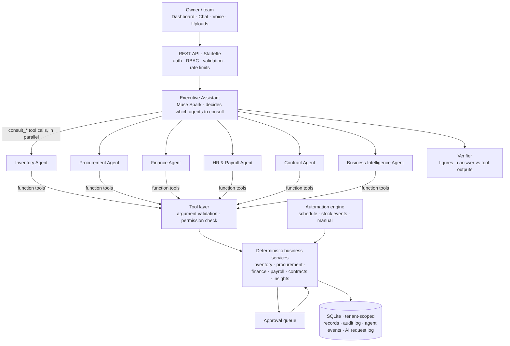

# Architecture

## The agent loop

1. `POST /api/assistant/chat` stores the user message, starts a background run and returns `session_id` + `run_id`.
2. **Executive Assistant** (Muse Spark) receives the business context, the conversation and one `consult_<agent>` tool per specialist the user's role can access. It decides which departments are needed and calls them — several in one turn when independent (`parallel_tool_calls: true`).
3. Each **specialist** is a separate Muse Spark loop (max 6 rounds) whose tools are only its own domain tools *and* only those the user's role permits. Tool calls run concurrently; results go back as `role: tool` messages with the matching `tool_call_id`.
4. Specialists return findings + their raw tool data; the Executive Assistant writes the consolidated answer.
5. The **verifier** extracts every significant figure from the answer and checks it against all tool outputs (tolerating rounding). The result ships with the answer ("12/12 figures verified" or a list of unverified figures).
6. Every step is written to `agent_events` (plan, agent_started, model_call with latency, tool_call, tool_result, action, verification, final). The UI polls these to animate the operations floor.

If the Meta API fails after retries, the run falls back to the deterministic planner and is labelled `fallback` with the reason.

## Why agents can't misbehave with money

- Agents never touch the database: they call predefined tools; arguments are validated against JSON Schema in code.
- Action tools (`draft_restock_purchase_orders`, `create_purchase_order`, `prepare_payroll`, `record_transaction`) only create drafts or records. Purchase orders and payroll enter `approval_requests`.
- Approvals are decided by people through the API. `approvals.decide` checks the approver's role and the business's spending limits (managers up to `manager_spending_limit`, payroll owner-only). Auto-approval exists only if the owner enables it with an explicit limit, and only for automation-originated orders.
- Supplier submission and salary payment are simulated and labelled as such in the audit log.

## Deterministic calculations

| Area | Method |
|---|---|
| Stock alert | `stock % = current ÷ max capacity × 100`; LOW < 20, URGENT < 10, CRITICAL < 5 (configurable) |
| Demand forecast | 28-day moving average of recorded usage; trend vs previous 28 days; days of cover; depletion date |
| Supplier choice | cheapest supplier whose lead time beats the projected stockout; else fastest; reliability breaks ties |
| Order size | refill to capacity, rounded to the supplier MOQ (rounded down if rounding up would overfill by >10%) |
| Cash forecast | committed scenario (recorded bills, open POs, recurring costs, payroll, receivables not yet overdue) and expected scenario (+ 28-day average sales − routine purchasing) |
| Payroll | basic/hourly + allowances + overtime (1.5×) + bonus − unpaid leave; deductions/contributions from versioned, verifiable rules |
| Affordability | `evaluate_affordability` tool sums the above so the model never adds money itself |

## Data model

```mermaid
erDiagram
  businesses ||--o{ business_members : has
  users ||--o{ business_members : joins
  businesses ||--|| business_settings : configures
  businesses ||--o{ products : stocks
  products ||--o{ inventory_movements : moves
  products ||--o{ stock_alerts : raises
  businesses ||--o{ suppliers : buys_from
  suppliers ||--o{ supplier_products : quotes
  products ||--o{ supplier_products : quoted
  suppliers ||--o{ purchase_orders : receives
  purchase_orders ||--o{ purchase_order_items : contains
  businesses ||--o{ transactions : records
  businesses ||--o{ invoices : bills
  businesses ||--o{ recurring_expenses : schedules
  businesses ||--o{ employees : employs
  employees ||--o{ attendance_records : logs
  employees ||--o{ leave_records : takes
  businesses ||--o{ payroll_rules : applies
  businesses ||--o{ payroll_runs : runs
  payroll_runs ||--o{ payroll_items : pays
  businesses ||--o{ documents : stores
  documents ||--o| contracts : source_of
  contracts ||--o{ contract_reminders : reminds
  businesses ||--o{ agent_sessions : chats
  agent_sessions ||--o{ agent_messages : holds
  agent_sessions ||--o{ agent_events : streams
  businesses ||--o{ automation_rules : automates
  automation_rules ||--o{ automation_runs : executes
  businesses ||--o{ recommendations : advises
  businesses ||--o{ approval_requests : gates
  businesses ||--o{ audit_logs : audits
  businesses ||--o{ reports : reports
```

Schema: [`backend/app/schema.sql`](../backend/app/schema.sql). Every business-owned row carries `business_id`; data access goes through helpers that require it (`db.get_owned`), and the business id comes only from the signed token, never from request parameters.

## Security

- PBKDF2-SHA256 passwords; HS256 JWTs with revocation on logout; secret generated per install if not provided.
- Roles OWNER, MANAGER, HR, FINANCE, INVENTORY, STAFF mapped to explicit permissions (`security.py`). Salary fields are stripped for roles without `salary.read`.
- Sliding-window rate limits (global and per sensitive endpoint, e.g. the assistant and uploads); upload size limit; file-type checks.
- Meta API key is server-side only; every AI request is logged (latency, tokens, errors) and visible in the Activity log.
- Full audit trail of user, agent, automation and system actions.
